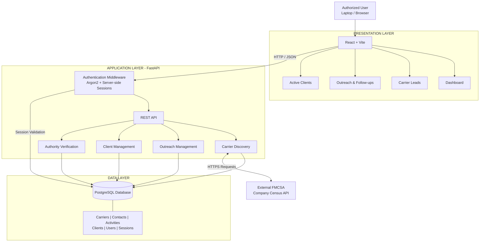
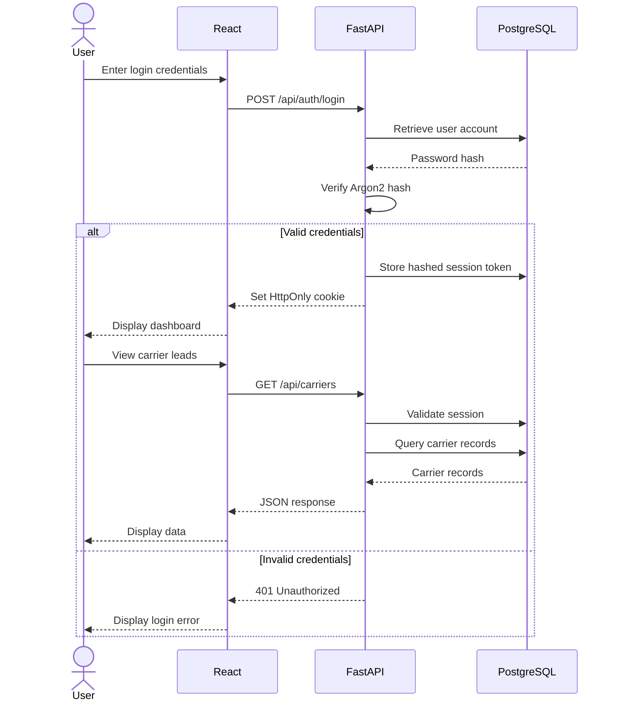
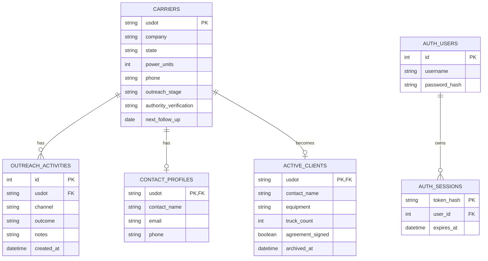
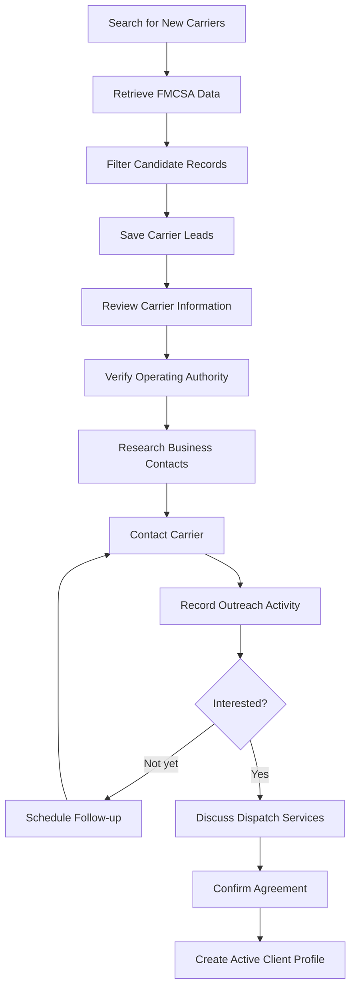
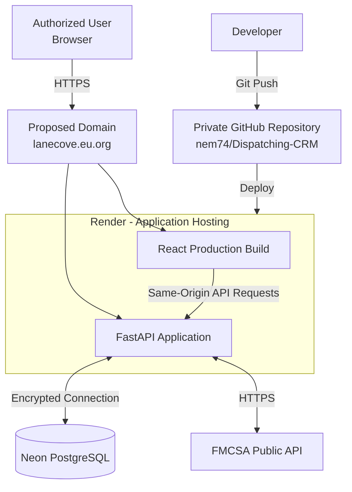

# 🚛 LaneCove

### Dispatching CRM | Freight Operations & Carrier Management

**Your carriers. Your clients. One workspace.**

LaneCove is a web-based carrier prospecting and customer relationship management platform designed for independent U.S. truck dispatching operations.

It helps dispatchers discover potential carrier clients, research company information, organize contacts, track outreach, schedule follow-ups, verify carrier authority, and manage active dispatching clients.

The system combines a React frontend, a FastAPI backend, and a PostgreSQL database in one integrated workspace.

> **Project Status:** Local MVP developed and tested for basic authentication and data access. Production deployment is in preparation.

**Developer:** [@nem74](https://github.com/nem74)  
**Repository:** [Dispatching-CRM](https://github.com/nem74/Dispatching-CRM)  
**Application Name:** LaneCove

---

## Table of Contents

1. [Project Overview](#project-overview)
2. [Features](#features)
3. [Technology Stack](#technology-stack)
4. [System Architecture](#system-architecture)
5. [Database Design](#database-design)
6. [Project Structure](#project-structure)
7. [Installation and Setup](#installation-and-setup)
8. [Running the Application](#running-the-application)
9. [Authentication and Security](#authentication-and-security)
10. [API Endpoints](#api-endpoints)
11. [Application Workflow](#application-workflow)
12. [Testing](#testing)
13. [Deployment Strategy](#deployment-strategy)
14. [Current Limitations](#current-limitations)
15. [Future Improvements](#future-improvements)
16. [Contributing](#contributing)
17. [License](#license)
18. [Developer](#developer)

---

## Project Overview

Independent freight dispatchers need to identify trucking companies, maintain communication records, follow up with potential clients, and manage relationships with carriers.

These processes are often handled through multiple spreadsheets, contact lists, and disconnected tools.

**LaneCove provides a centralized solution.**

Its primary objectives are to:

- Simplify carrier prospecting.
- Reduce repetitive manual research.
- Organize carrier business information.
- Track conversations and outreach activity.
- Improve follow-up consistency.
- Support manual authority verification.
- Separate prospective carriers from active clients.
- Provide visibility into prospecting performance.

LaneCove is a **carrier prospecting and dispatch CRM**, not a freight load board or a complete transportation management system.

### Target Users

The application is designed for:

- Independent truck dispatchers
- Small freight dispatching agencies
- Carrier acquisition specialists
- Freight operations administrators

### Initial Scope

The current system focuses on U.S. trucking companies, particularly smaller fleets with approximately 1–5 reported power units.

Carrier information is retrieved from public FMCSA registration datasets and organized for prospecting purposes.

---

## Features

### 1. Dashboard

The dashboard provides an overview of carrier prospecting and client relationships.

**Key capabilities:**

- Total carrier records
- Interested prospects
- Outreach pipeline statistics
- Carriers awaiting verification
- Follow-ups due
- Client-related statistics
- Data visualizations
- Recent carrier records

Charts and statistics help the user understand the current state of the prospecting pipeline.

### 2. Carrier Discovery

LaneCove integrates with the public FMCSA Company Census dataset to discover potential trucking carrier prospects.

**Capabilities:**

- Search supported U.S. states.
- Filter potential carriers by fleet size.
- Focus on relevant carrier classifications.
- Retrieve business registration information.
- Identify records using USDOT numbers.
- Save new prospects in PostgreSQL.
- Avoid inserting duplicate USDOT records.

**Important:** FMCSA Census data is useful for discovery but does not, by itself, confirm active operating authority.

### 3. Carrier Leads

A centralized directory for managing prospective clients.

**Capabilities:**

- View saved carrier records.
- Search by company name, USDOT number, or phone.
- Filter by state.
- Filter by outreach stage.
- Filter by verification status.
- Browse paginated results.
- Export the currently displayed records to CSV.
- Open individual carrier records.

### 4. Outreach Management

Tracks the relationship between the dispatcher and potential clients.

**Supported outreach stages:**

| Stage | Description |
|---|---|
| Not contacted | No outreach recorded |
| Contacted | Initial communication attempted or completed |
| Replied | Carrier has responded |
| Interested | Carrier has expressed interest |
| Follow-up | Further communication is required |
| Client | Carrier has reached the client stage of the outreach pipeline |

Users can:

- Update outreach stages.
- Add conversation notes.
- Record contact activity.
- Schedule follow-up dates.
- Maintain current prospect status.

**Note:** Setting the outreach stage to `Client` does not automatically create an Active Client record.

### 5. Outreach History

Maintains a history of individual communication activities.

Examples of communication channels include:

- Phone
- Email
- LinkedIn
- Facebook
- Other business communication methods

Activity records can capture the communication outcome, notes, and follow-up details.

This allows users to review previous conversations before contacting a carrier again.

### 6. Follow-up Management

Helps users stay organized when managing multiple prospects.

**Capabilities:**

- View due follow-ups.
- Identify overdue follow-ups.
- View upcoming follow-ups.
- Access the related carrier record.
- Update follow-up information.

### 7. Carrier Verification

Supports manual verification of trucking company authority.

**Stored verification information includes:**

- Verification status
- Verification source
- Review notes
- Review date

The application supports recording verification results, but users must consult authoritative sources to confirm operating status.

**Official source:** [Federal Motor Carrier Safety Administration](https://www.fmcsa.dot.gov/)

### 8. Active Clients

Maintains a separate directory of carriers that have entered into dispatching service relationships.

Client profiles can include:

- USDOT number
- Company name
- Contact details
- Equipment information
- Truck count
- Dispatch fee percentage
- Service start date
- Agreement status
- Operational notes

The module also supports archiving client records.

**Design principle:** Prospective carriers and confirmed dispatching clients are managed separately.

The Active Clients interface is implemented, but complete create/archive integration testing remains part of the pre-deployment checklist.

### 9. Authentication

LaneCove uses a private login system to prevent unauthorized access to carrier and client records.

**Implemented capabilities include:**

- Username and password login
- Argon2 password hashing
- HttpOnly authentication cookies
- Server-side session storage
- Session expiration
- Logout and session invalidation
- Basic failed-login protection
- Authentication middleware for protected API endpoints

Public registration is not enabled.

---

## Technology Stack

### Frontend

| Technology | Purpose |
|---|---|
| React | Component-based user interface |
| Vite | Frontend development and build tooling |
| JavaScript | Frontend application logic |
| CSS | Styling and responsive layouts |
| Lucide React | Interface icons |
| Recharts | Dashboard charts and visualizations |

### Backend

| Technology | Purpose |
|---|---|
| Python | Backend programming language |
| FastAPI | REST API framework |
| Pydantic | Request validation |
| Psycopg | PostgreSQL database connectivity |
| Requests | External API communication |
| Argon2 | Secure password hashing |

### Database

| Technology | Purpose |
|---|---|
| PostgreSQL | Relational data storage |

### Development Tools

| Tool | Purpose |
|---|---|
| Git | Version control |
| GitHub | Source code repository |
| VS Code | Development environment |
| Ubuntu Linux | Local development environment |

---

## System Architecture

LaneCove follows a **three-tier architecture** consisting of a presentation layer, an application layer, and a data layer.

The backend follows a **modular monolith architecture**, meaning business functions are organized into separate modules but operate within a single FastAPI application.

### High-Level Architecture Diagram



### Layer Responsibilities

#### Presentation Layer

The presentation layer is responsible for displaying information and handling user interactions.

**Responsibilities:**

- Render pages and components.
- Display carrier information.
- Manage frontend application state.
- Collect form input.
- Send requests to FastAPI.
- Display server responses and errors.
- Manage the login interface.

The frontend does not connect directly to PostgreSQL.

#### Application Layer

The application layer handles business logic and security.

**Responsibilities:**

- Authenticate users.
- Validate incoming requests.
- Manage carrier records.
- Process outreach updates.
- Retrieve follow-up information.
- Manage active clients.
- Record verification results.
- Retrieve FMCSA data.
- Communicate with PostgreSQL.

FastAPI exposes REST endpoints under `/api`.

#### Data Layer

The data layer provides persistent storage.

**Responsibilities:**

- Store carrier information.
- Preserve outreach history.
- Store follow-up dates.
- Maintain active-client profiles.
- Store verification results.
- Store authentication accounts and sessions.
- Enforce database relationships.

### Request and Response Flow

1. The user opens LaneCove in a web browser.
2. React displays the login screen.
3. Login credentials are sent to FastAPI.
4. FastAPI verifies the account and creates a session.
5. The browser receives an HttpOnly session cookie.
6. React sends authenticated requests to the backend.
7. FastAPI validates the session and processes requests.
8. PostgreSQL retrieves or stores the required data.
9. FastAPI returns JSON responses.
10. React updates the interface.

### Authentication Sequence



---

## Database Design

LaneCove uses PostgreSQL as its primary database.

### Logical Database Structure



This is a simplified logical model. The actual PostgreSQL schema contains additional fields and an authentication login-attempt tracking table.

### Main Data Entities

| Entity | Description |
|---|---|
| Carriers | Core company information and prospecting status |
| Outreach Activities | History of communications with carriers |
| Contact Profiles | Manually researched business contacts |
| Active Clients | Carriers with confirmed dispatching relationships |
| Authentication Users | Application accounts and password hashes |
| Authentication Sessions | Server-side login sessions |
| Login Attempts | Failed login tracking for rate limiting |

### Data Integrity

Carrier records are identified by USDOT number.

Related records reference the appropriate carrier so that outreach activities, contact information, and client profiles remain associated with the correct trucking company.

Database constraints and input validation help reduce duplicate and inconsistent data.

---

## Project Structure

The project is organized into backend, frontend, and supporting files.

```text
Dispatching-CRM/
│
├── api.py
├── auth_security.py
├── create_admin.py
├── db_access.py
├── carrier_search.py
│
├── requirements-api.txt
├── .gitignore
├── README.md
│
├── frontend/
│   ├── index.html
│   ├── package.json
│   ├── vite.config.js
│   │
│   └── src/
│       ├── main.jsx
│       ├── App.jsx
│       ├── AuthGate.jsx
│       ├── api.js
│       ├── index.css
│       ├── auth.css
│       │
│       └── components/
│           └── ... 
│
└── ... additional migration and development files
```

**Note:** The GitHub repository is named `Dispatching-CRM`, while the existing local development folder is named `silvanne-carrier-finder`.

The codebase may also contain earlier Streamlit scripts, SQL setup scripts, development utilities, and local data directories.

Sensitive files such as `.env`, virtual environments, and private database backups should not be committed.

---

## Installation and Setup

### Prerequisites

Ensure the following are installed:

- Python 3
- PostgreSQL
- Node.js
- npm
- Git

Use a current Node.js version compatible with the project's Vite release.

### 1. Clone the Repository

```bash
git clone https://github.com/nem74/Dispatching-CRM.git
cd Dispatching-CRM
```

The repository must contain the pushed project code, and a private repository requires GitHub access.

### 2. Create a Virtual Environment

```bash
python3 -m venv .venv
source .venv/bin/activate
```

### 3. Install Backend Dependencies

```bash
python -m pip install --upgrade pip
python -m pip install -r requirements-api.txt
python -m pip install argon2-cffi
```

The authentication dependency `argon2-cffi` should also be recorded in the project's requirements file before deployment.

### 4. Configure PostgreSQL

Create a PostgreSQL database and a dedicated database user.

The existing local development database is named:

```text
silvanne_carrier_finder
```

Configure the credentials expected by `db_access.py` through the application's private environment configuration.

Do not place real passwords in source code.

### 5. Initialize Database Tables

LaneCove requires the carrier database schema and the supporting tables for outreach, contact profiles, active clients, and authentication.

The existing project contains database setup and migration work from earlier development stages.

**A complete, automated fresh-install migration is not yet available.**

For a new installation:

1. Create the PostgreSQL database.
2. Apply the carrier schema and required migration scripts from the project.
3. Confirm the required application tables exist.
4. Create an initial application account.
5. Test the database connection.

Do not rerun old imports against an existing production database without a backup.

### 6. Create the Administrator Account

From the project root:

```bash
python create_admin.py
```

Follow the prompts to create a username and password.

Passwords are hashed with Argon2 before storage.

---

## Running the Application

### Start the Backend

From the project root:

```bash
source .venv/bin/activate

python -m uvicorn api:app \
  --reload \
  --host 127.0.0.1 \
  --port 8000
```

The development API runs at:

```text
http://127.0.0.1:8000
```

### Start the Frontend

Open another terminal:

```bash
cd frontend

npm install

npm run dev
```

Open the application in your browser:

```text
http://127.0.0.1:5173
```

The frontend uses a local API proxy to communicate with FastAPI.

### API Health Check

Visit:

```text
http://127.0.0.1:8000/api/health
```

The expected successful response includes:

```json
{
  "status": "ok",
  "database": "connected"
}
```

### Development API Documentation

FastAPI's interactive documentation is normally available at:

```text
http://127.0.0.1:8000/docs
```

Production access to API documentation should be restricted or disabled.

---

## Authentication and Security

LaneCove uses server-side authentication rather than relying solely on the frontend.

### Authentication Design

1. Users submit credentials through the login screen.
2. FastAPI verifies passwords using Argon2.
3. A cryptographically random session token is generated.
4. Only a hash of the token is stored in PostgreSQL.
5. The browser receives an HttpOnly cookie.
6. Protected API requests are checked against the session store.
7. Logout invalidates the stored session.

### Current Security Features

- Argon2 password hashing
- HttpOnly cookies
- Server-side session storage
- Login-attempt limiting
- Session expiration
- Protected API routes
- Logout and session invalidation
- Basic request-origin protections

### Security Tests Completed

The following local tests have passed:

- Login required before accessing the dashboard
- Invalid password rejected
- Valid credentials accepted
- Carrier Leads accessible after login
- Active Clients accessible after login
- Logout returns to the login interface
- Refresh after logout does not restore access
- Unauthenticated direct API requests return HTTP 401

### Production Security Requirements

Before public deployment, the application must be configured and tested for:

- HTTPS
- Secure authentication cookies
- Production origin restrictions
- Trusted host configuration
- CSRF protection review
- Protected API documentation
- Safe database credentials
- Encrypted database connections
- Backups and recovery
- Dependency security checks
- Complete API authorization testing

**Warning:** The local development configuration should not be exposed directly to the public internet.

---

## API Endpoints

LaneCove provides REST APIs for its primary operations.

### Authentication

| Method | Endpoint | Purpose |
|---|---|---|
| POST | `/api/auth/login` | Authenticate a user |
| GET | `/api/auth/me` | Check the current session |
| POST | `/api/auth/logout` | Terminate the session |

### Carriers

| Method | Endpoint | Purpose |
|---|---|---|
| GET | `/api/carriers` | Retrieve and filter carriers |
| GET | `/api/carriers/{usdot}` | Retrieve an individual carrier |
| PATCH | `/api/carriers/{usdot}/outreach` | Update outreach information |
| PATCH | `/api/carriers/{usdot}/verification` | Save verification details |

### Discovery and Dashboard

| Method | Endpoint | Purpose |
|---|---|---|
| GET | `/api/stats` | Retrieve dashboard statistics |
| GET | `/api/followups` | Retrieve follow-up records |
| POST | `/api/discover` | Discover new carriers |
| GET | `/api/health` | Check application/database health |

### Active Clients

| Method | Endpoint | Purpose |
|---|---|---|
| GET | `/api/active-clients` | Retrieve active clients |
| POST | `/api/active-clients` | Add an active client |
| POST | `/api/active-clients/{usdot}/archive` | Archive a client |

Additional endpoints support outreach history and contact-profile management.

Endpoint availability and exact request schemas should be checked against the current `api.py` implementation.

Protected endpoints require a valid authenticated session.

---

## Application Workflow

### Carrier Prospecting



### Active Client Management

Once a carrier enters into a dispatching agreement, the dispatcher creates an Active Client profile.

The profile stores relevant operational information and helps distinguish paying clients from prospective customers.

Client records can be archived when the business relationship ends.

---

## Testing

### Frontend Build

From the frontend directory:

```bash
npm run build
```

This verifies that the React application can compile for production.

### Python Syntax Check

From the project root:

```bash
python -m py_compile api.py auth_security.py create_admin.py
```

### Authentication Test

Without an authenticated session:

```bash
curl -i http://127.0.0.1:8000/api/carriers
```

Expected result:

```text
HTTP/1.1 401 Unauthorized
```

The same protection should apply to sensitive API endpoints.

### Additional Tests Required

- Active Client creation and archival
- Outreach history persistence
- Session expiration
- Database backup restoration
- Full endpoint authorization testing
- Production HTTPS configuration
- Cross-device browser testing
- Production database connectivity

---

## Deployment Strategy

LaneCove is currently running in a local development environment.

The planned deployment will make the application available online without requiring the developer's laptop to remain powered on.

### Proposed Production Infrastructure

| Component | Proposed Service |
|---|---|
| Source Control | GitHub |
| Application Hosting | Render |
| Frontend | Compiled React assets |
| Backend | FastAPI |
| Database | Neon PostgreSQL |
| Custom Domain | `lanecove.eu.org`, pending approval |
| Transport Security | HTTPS |

### Deployment Architecture



### Planned Deployment Steps

1. Push source code to a private GitHub repository.
2. Verify sensitive files are excluded.
3. Prepare a reproducible production build.
4. Configure the cloud PostgreSQL database.
5. Apply database migrations.
6. Deploy the FastAPI application.
7. Serve the compiled React frontend.
8. Configure HTTPS and secure cookies.
9. Configure the approved custom domain.
10. Test authentication and database operations.
11. Establish database backup and recovery procedures.
12. Complete production acceptance testing.

The production architecture is **planned, not yet deployed**.

### Deployment Considerations

Free hosting may introduce:

- Application sleep periods
- Cold-start delays
- Usage limits
- Limited support
- Database storage constraints

These limitations should be evaluated before relying on the system for time-sensitive business operations.

---

## Current Limitations

LaneCove currently focuses on carrier prospecting and client relationship management.

The following features are not yet implemented as complete operational modules:

- Automated load booking
- Real-time load-board integration
- Driver scheduling
- Vehicle management
- Freight shipment tracking
- Invoice generation
- Dispatch fee collection
- Automated email campaigns
- Multi-factor authentication
- Role-based access control
- Automated database migrations
- Automated backup and recovery

Carrier authority verification requires manual review of official records.

---

## Future Improvements

### Phase 1: Carrier Prospecting

- [x] FMCSA carrier discovery
- [x] Carrier database
- [x] Search and filtering
- [x] Outreach stage management
- [x] Follow-up tracking
- [x] Manual verification records

### Phase 2: Client Relationship Management

- [x] Outreach history functionality
- [x] Contact management functionality
- [x] Active Clients interface
- [x] Client archival functionality
- [ ] Complete end-to-end integration tests

### Phase 3: Authentication and Security

- [x] Private login system
- [x] Argon2 password hashing
- [x] Server-side sessions
- [x] Logout
- [x] Basic unauthorized-access tests
- [ ] Production security hardening
- [ ] Password recovery
- [ ] Multi-factor authentication
- [ ] Role-based permissions

### Phase 4: Deployment

- [ ] GitHub source upload
- [ ] Managed PostgreSQL setup
- [ ] Application hosting
- [ ] HTTPS configuration
- [ ] Custom domain configuration
- [ ] Production monitoring
- [ ] Backup and recovery testing

### Phase 5: Dispatch Operations

- [ ] Truck and driver management
- [ ] Load assignment tracking
- [ ] Freight lane planning
- [ ] Rate confirmation management
- [ ] Dispatch fee calculations
- [ ] Revenue reporting
- [ ] Document management

---

## Contributing

LaneCove is currently maintained as a private development project.

Development changes should follow these principles:

1. Never commit sensitive credentials.
2. Keep database changes documented.
3. Test backend and frontend modifications.
4. Preserve existing carrier and client records.
5. Use descriptive Git commit messages.
6. Review security implications before deploying changes.

External contributions are not currently being requested.

---

## License

No open-source license has currently been assigned to LaneCove.

The project is intended to remain private unless the owner chooses to release it publicly.

---

## Developer

**Developed by:** [nem74](https://github.com/nem74)

**GitHub Repository:**  
https://github.com/nem74/Dispatching-CRM

**Project:** LaneCove

**Category:** Freight Operations & Carrier Relationship Management

**Technology:** React, FastAPI, PostgreSQL

**Current Stage:** Local MVP / Pre-deployment

---

<div align="center">

### LaneCove

**Your carriers. Your clients. One workspace.**

Built to simplify carrier prospecting and freight dispatch operations.

</div>
